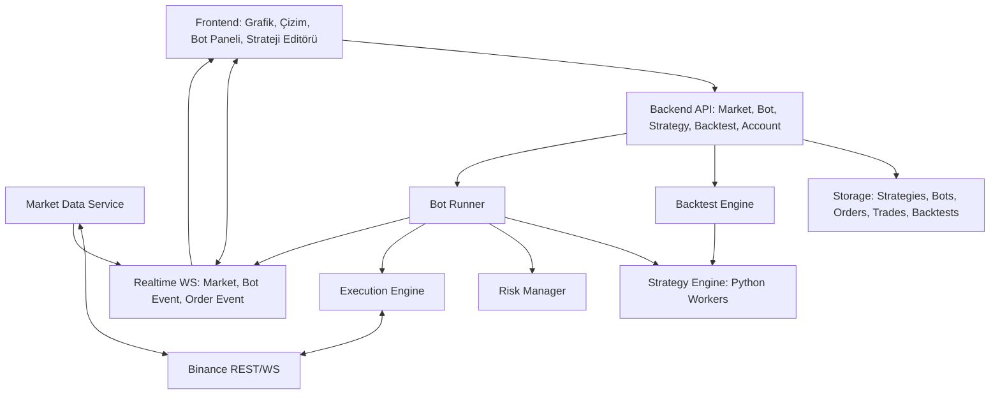
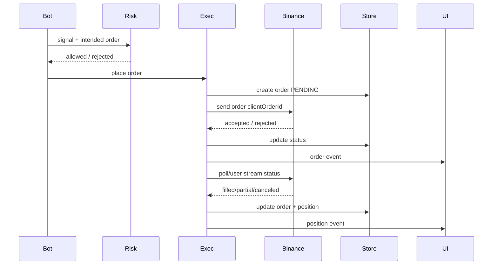

# NexusTrade Pro Mimari Planı

## Ürün Amacı

NexusTrade Pro, TradingView benzeri fakat lokal çalışan bir trading ve strateji laboratuvarıdır.
Ana hedefler:

- Binance API üzerinden canlı piyasa verisi çekmek.
- Kullanıcının grafik üzerinde analiz yapabilmesini sağlamak.
- Python ile yazılan stratejileri editörde oluşturmak ve saklamak.
- Geçmiş veri üzerinde stratejileri doğru şekilde backtest etmek.
- Başarılı stratejileri paper modda ve daha sonra live modda botlara bağlamak.
- Emir, pozisyon ve risk takibini kesintisiz yapmak.

Öncelik sırası:

1. Güvenlik
2. Al-sat işlemlerinde kesintisiz ve aksaksız emir takibi
3. Backtest doğruluğu
4. Stabil ve kullanıcı dostu strateji editörü

## Mevcut Durum

Projede üç ayrı katman aynı anda var:

### 1. TypeScript Backend

Ana omurga olarak seçilmelidir.

Önemli dosyalar:

- `src/server.ts`: HTTP server, WebSocket server, graceful shutdown.
- `src/app.ts`: Express uygulaması, middleware, route bağlantıları.
- `src/services/binance/client.ts`: Binance REST client, retry, timeout, signed endpoint altyapısı.
- `src/services/binance/stream.ts`: Binance stream yönetimi.
- `src/services/wsServer.ts`: Frontend WebSocket yayını.
- `src/bot/manager.ts`: Bot yaşam döngüsü yönetimi.
- `src/bot/runner.ts`: Tek botun candle, sinyal, pozisyon ve risk akışı.
- `src/bot/execution.ts`: Paper/live execution interface.
- `src/workers/pool.ts`: Python worker pool.
- `src/storage/json/*`: JSON tabanlı kalıcı veri.

Bu katman uzun vadeli backend olmalıdır.

### 2. Tek Dosyalık Frontend

- `public/index.html`

Şu an hızlı prototip ekranıdır:

- Grafik
- Çizim araçları
- Bot paneli
- Strateji editörü
- Backtest modalı
- API bağlantı ekranı

Kısa vadede kullanılabilir, fakat uzun vadede büyütülmemelidir.

### 3. React Frontend

- `web/`

Uzun vadeli kullanıcı arayüzü burada olmalıdır.

Önemli dosyalar:

- `web/src/components/chart/Chart.tsx`
- `web/src/components/bots/*`
- `web/src/components/layout/*`
- `web/src/api/*`
- `web/src/hooks/*`

Hedef, tek dosyalık ekranın zamanla buraya taşınmasıdır.

### 4. Python Strateji Katmanı

- `python/strategies/*`
- `python/workers/*`
- `python/indicators/*`

Python stratejileri doğrudan Node içinde eval edilmemeli; worker process içinde izole çalıştırılmalıdır.

## Hedef Mimari



## Backend Katmanları

### Market Data Service

Sorumluluklar:

- Binance REST klines, ticker, order book.
- Binance WebSocket stream abonelikleri.
- Candle normalization.
- Reconnect ve backoff.
- Rate limit takibi.
- Frontend ve botlar için tek veri kaynağı.

Kurallar:

- Kapanmamış mum sinyal üretiminde kullanılmamalıdır.
- Backtest ve live aynı candle formatını kullanmalıdır.
- Veri boşluğu oluşursa loglanmalı ve mümkünse tamamlanmalıdır.

### Strategy Service

Sorumluluklar:

- Strateji dosyalarını listelemek, kaydetmek, versiyonlamak.
- Python kodunu doğrulamak.
- Strateji metadata tutmak.
- Parametreleri saklamak.

Önerilen metadata:

```json
{
  "id": "strategy-id",
  "name": "RSI Mean Reversion",
  "language": "python",
  "version": 3,
  "params": {},
  "createdAt": 0,
  "updatedAt": 0
}
```

### Strategy Worker Engine

Sorumluluklar:

- Python stratejilerini process izolasyonu içinde çalıştırmak.
- `load`, `tick`, `backtest`, `drop` komutlarını desteklemek.
- Timeout uygulamak.
- Worker ölürse yeniden başlatmak.

Kurallar:

- Strateji kodu Node process içinde çalıştırılmamalıdır.
- Dosya sistemi ve network erişimi strateji kodu için kısıtlanmalıdır.
- Her strateji çağrısı deterministic input almalıdır.

### Backtest Engine

Sorumluluklar:

- Geçmiş veriyi çekmek.
- Stratejiyi aynı live engine ile çalıştırmak.
- Emir simülasyonu yapmak.
- Komisyon, slippage, spread, candle içi SL/TP önceliğini modellemek.
- Sonuçları kalıcı olarak saklamak.

Backtest çıktısı:

- Total return
- Win rate
- Profit factor
- Max drawdown
- Sharpe / Sortino
- Trade list
- Equity curve
- Parametreler
- Veri aralığı
- Komisyon/slippage varsayımları

Kritik kural:

Backtest ve live aynı sinyal üretim kodunu kullanmalıdır. Aksi halde backtest sonucu canlıya taşınamaz.

### Bot Runner

Sorumluluklar:

- Bot status yönetimi.
- Candle stream aboneliği.
- Strateji tick çağrısı.
- Risk guard.
- Sinyali execution engine'e iletmek.
- Pozisyon state güncellemek.
- Event yayınlamak.

Önerilen durum makinesi:

```text
draft
  -> backtested
  -> paper_running
  -> paper_paused
  -> live_ready
  -> live_running
  -> live_paused
  -> error
  -> stopped
```

### Execution Engine

Sorumluluklar:

- Paper order simülasyonu.
- Live Binance order gönderimi.
- Client order id üretimi.
- Emir durum takibi.
- Partial fill yönetimi.
- Cancel/replace.
- Crash sonrası reconciliation.

Live emir için zorunlu alanlar:

- `clientOrderId`
- `botId`
- `signalId`
- `symbol`
- `side`
- `quantity`
- `orderType`
- `intendedPrice`
- `status`
- `exchangeOrderId`
- `createdAt`
- `updatedAt`

Live mod açılmadan önce tamamlanması gerekenler:

- API key encryption
- Idempotent order placement
- Order status polling
- User data stream
- Open order reconciliation
- Open position reconciliation
- Kill switch

### Risk Manager

Sorumluluklar:

- Günlük maksimum zarar limiti.
- Bot başına maksimum pozisyon büyüklüğü.
- Sembol başına maksimum açık risk.
- Aynı sembolde çakışan botları engelleme veya uyarma.
- Live moda geçiş guard'ı.
- Acil durdurma.

## Frontend Katmanları

### Grafik

Sorumluluklar:

- Canlı mum grafiği.
- Geçmiş veri lazy loading.
- Çizim araçları.
- Alarm seviyeleri.
- Bot sinyal/formasyon katmanı.

Çizim araçları:

- Yatay çizgi
- Trend çizgisi
- Dikdörtgen/bölge
- Fibonacci retracement
- Silme/düzenleme

Çizimler zaman/fiyat koordinatında saklanmalıdır, piksel bazlı saklanmamalıdır.

### Strateji Editörü

Sorumluluklar:

- Python kod düzenleme.
- Validate.
- Kaydet/yükle.
- Parametre tanımlama.
- Backtest başlatma.
- Sonuç karşılaştırma.
- Versiyonlama.

Editör hedefleri:

- Kullanıcı dostu olmalı.
- Kod hatalarını anlaşılır göstermeli.
- Backtest sonucu stratejiyle birlikte saklanmalı.
- Canlıya alma için minimum başarı/risk eşiği tanımlanabilmeli.

### Bot Paneli

Sorumluluklar:

- Bot oluşturma.
- Bot başlat/durdur/duraklat.
- Paper/live ayrımı.
- Açık pozisyon.
- Açık emir.
- Son sinyal.
- PnL.
- Son hata.
- Heartbeat.

## Güvenlik Planı

Öncelikli işler:

1. `.env` içindeki secret değerlerinin gerçek ve güçlü olduğundan emin ol.
2. API key ve secret plaintext saklanmamalı.
3. Live mode default kapalı olmalı.
4. Withdraw izni olan API key reddedilmeli veya en azından kritik uyarı verilmeli.
5. Loglarda apiKey/apiSecret/token/order signature asla görünmemeli.
6. Frontend yalnızca local origin veya izinli originlerden erişilebilir olmalı.
7. Strategy worker sandbox kuralları netleşmeli.

## Backtest Doğruluk Planı

Backtestte zorunlu varsayımlar:

- Komisyon oranı.
- Slippage modeli.
- Spread modeli.
- Candle içinde önce SL mi TP mi geldi belirsizliği.
- Market/limit order fill modeli.
- Minimum quantity / step size.
- Lookahead bias kontrolü.

Öneri:

Backtest raporu her zaman şu satırı göstermeli:

```text
Varsayımlar: fee=%0.1, slippage=..., fill=..., data=Binance spot, interval=...
```

## Emir Takibi Planı

Live execution için event akışı:



## Teknik Yol Haritası

### Faz 1: Mimari Temizlik

- `src/` TypeScript backend ana backend kabul edilecek.
- `public/index.html` geçici prototip olarak işaretlenecek.
- `web/` React frontend uzun vadeli hedef olacak.
- API sözleşmeleri dokümante edilecek.

### Faz 2: Güvenlik

- API key encryption.
- Secret redaction testleri.
- Live mode guard.
- CORS/local access policy.

### Faz 3: Backtest Motoru

- Worker tabanlı backtest.
- Fee/slippage/fill modelleri.
- Backtest run storage.
- Strategy version ile backtest bağlama.

### Faz 4: Paper Trading Stabilizasyonu

- Bot lifecycle netleşmesi.
- Paper execution event log.
- Risk manager.
- Pozisyon state persistence.

### Faz 5: Live Trading Hazırlığı

- LiveExecution implementasyonu.
- Client order id.
- Order reconciliation.
- User data stream.
- Kill switch.

### Faz 6: Frontend Taşıma

- `public/index.html` özellikleri `web/` React'e taşınacak.
- Chart + drawing tools.
- Strategy editor.
- Backtest dashboard.
- Bot operations panel.

## Kısa Vadeli Net Kararlar

1. Yeni backend geliştirmeleri `src/` altında yapılacak.
2. Yeni frontend geliştirmeleri mümkünse `web/` altında yapılacak.
3. `public/index.html` sadece geçici kullanım ve prototip için kalacak.
4. Live trading, execution/reconciliation tamamlanmadan açılmayacak.
5. Backtest sonuçları, strateji versiyonu ve kullanılan parametrelerle birlikte saklanacak.

